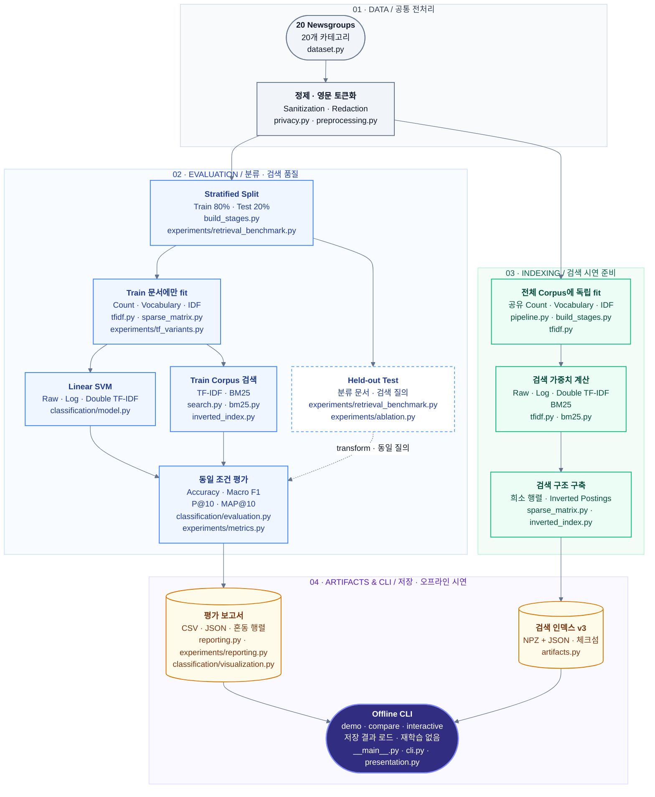
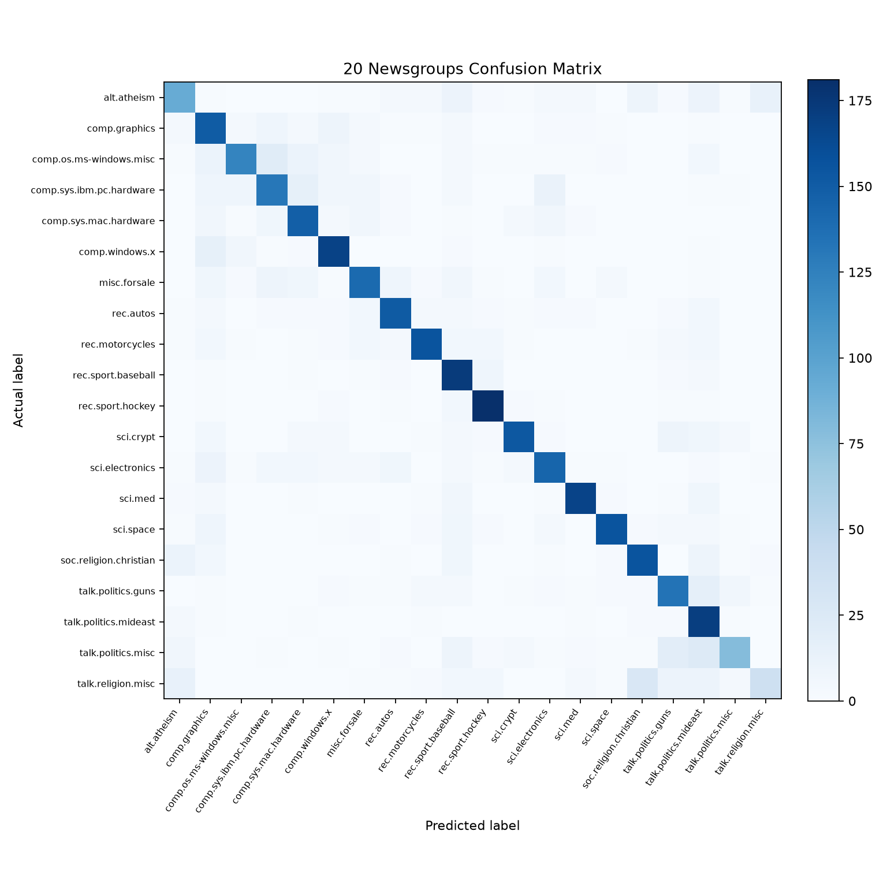

# Document Retrieval & Classification System

### Quick Start — 한 번 준비하고 한 명령으로 시연

Python 3.10 이상과 uv, make가 필요하다. 핵심 검색 계산은 NumPy와 Python 표준 라이브러리로 직접 구현한다.

```bash
# 최초 1회: 설치·검사·테스트·패키지 빌드·인덱스 준비·벤치마크
make ready

# 검색과 비교를 선택하는 대화형 메뉴
make interactive

# 발표: 저장된 인덱스와 결과만 읽는 오프라인 시연
make demo

make run ARGS='--query "space shuttle orbit" --topk 5'
make run ARGS='--query "space shuttle orbit" --tf-mode log --strategy inverted'
make run ARGS='--query "space shuttle orbit" --method bm25'
make compare ARGS='--query "space shuttle orbit"'
```

`make ready` 하나로 전체 준비를 끝낸다. `make`만 실행해도 같은 작업을 수행한다. 내부에서 `setup` → `check` → `test` → `build` → `prepare` → `benchmark`를 순서대로 실행하고, 실패한 단계가 있으면 즉시 중단한다. `make -j ready`로 실행해도 준비 단계의 순서는 유지한다. 최초 실행은 데이터 다운로드·학습·평가를 포함하므로 시간이 걸릴 수 있다. 준비가 끝나면 `make interactive` 또는 `make demo`로 실행한다. 직접 실행할 때는 `uv run --frozen python -m document_system interactive`처럼 패키지 모듈을 사용한다. 실행 명령은 내부에서 `uv run --frozen`을 사용하므로 가상환경을 직접 활성화할 필요가 없다. 준비가 끝난 환경에서는 실행할 때마다 `ready`를 반복할 필요가 없다. `demo`는 다운로드·학습을 시작하지 않는다.

`make interactive`의 **7번 Show Full Document Text**에서 검색 결과의 문서 ID를 입력하면 카테고리와 정제된 전체 본문을 확인할 수 있다. 본문은 7번을 처음 사용할 때 로컬 dataset cache에서 읽으며, 다운로드·재학습 없이 같은 메뉴 세션에서 재사용한다. 소문자 영문 정규화와 기존 redaction이 적용된 텍스트를 길이 제한 없이 표시한다. 캐시가 없거나 인덱스와 다른 corpus이면 안내 후 메뉴로 돌아간다.

## 프로젝트 소개

20 Newsgroups의 기존 20개 주제를 검색하고 분류하며, TF 가중치·BM25·역색인의 효과를 같은 조건에서 비교하는 학습 프로젝트다. 기존 NumPy TF-IDF, CSR 유사 희소 행렬, SGD 기반 Linear SVM을 확장했다. Dense 검색, LLM, 웹 서버와 외부 검색 패키지는 도입하지 않는다.

## 핵심 특징

- Raw / Log / Double TF-IDF: 공통 Count Matrix와 smoothed IDF 재사용, L2 정규화.
- BM25: NumPy로 직접 계산한 IDF, TF 포화, 문서 길이 정규화, unique 질의 단어.
- Scan / Inverted: 동일한 점수·순위 계약, 후보만 누적하고 heap으로 Top-K 선택.
- 분류는 train-only fit, 검색 시연은 전체 corpus fit, 검색 품질은 train corpus와 held-out 질의로 평가.
- 버전 3 NPZ/JSON 인덱스: 공유 vocabulary·희소 구조·메타데이터, 체크섬과 corpus fingerprint, 재학습 없는 복원.
- 표준 라이브러리 CLI: 여섯 단계 demo, 개별 검색·비교·메뉴, 비TTY/NO_COLOR 환경에서 같은 정보 제공.

## 아키텍처

아래 모듈 경로는 `src/document_system/` 기준이며, 표의 링크로 해당 소스 파일을 확인할 수 있다. 흐름도에는 각 단계의 구현 모듈을 함께 표시한다.

| 구성 요소 | 모듈 경로 (`src/document_system/` 기준) | 역할 |
|---|---|---|
| 데이터·전처리 | [dataset.py](src/document_system/dataset.py), [privacy.py](src/document_system/privacy.py), [preprocessing.py](src/document_system/preprocessing.py) | 기존 데이터 로딩·redaction·토큰화 |
| 벡터화·희소 행렬 | [tfidf.py](src/document_system/tfidf.py), [sparse_matrix.py](src/document_system/sparse_matrix.py) | 공유 Count Matrix, TF 변환, IDF와 L2 정규화 |
| 검색 | [search.py](src/document_system/search.py), [bm25.py](src/document_system/bm25.py), [inverted_index.py](src/document_system/inverted_index.py) | 공통 SearchResult, Scan·posting·BM25 검색 |
| 분류·시각화 | [classification/model.py](src/document_system/classification/model.py), [classification/evaluation.py](src/document_system/classification/evaluation.py), [classification/visualization.py](src/document_system/classification/visualization.py) | Linear SVM 학습·예측, 분류 평가·오분류 분석, 혼동 행렬 시각화 |
| 수치 검증 | [validation.py](src/document_system/validation.py) | TF-IDF 계산과 sklearn 결과 비교 |
| 빌드·인덱스 저장 | [pipeline.py](src/document_system/pipeline.py), [build_stages.py](src/document_system/build_stages.py), [artifacts.py](src/document_system/artifacts.py) | 분류·검색 빌드 단계 실행, 전체 corpus 인덱스 저장·복원 |
| 실험·검색 품질 평가 | [experiments/retrieval_benchmark.py](src/document_system/experiments/retrieval_benchmark.py), [experiments/tf_variants.py](src/document_system/experiments/tf_variants.py), [experiments/metrics.py](src/document_system/experiments/metrics.py), [experiments/ablation.py](src/document_system/experiments/ablation.py) | 동일 split/query의 E1–E6 평가·불용어 ablation |
| 보고서 | [reporting.py](src/document_system/reporting.py), [experiments/reporting.py](src/document_system/experiments/reporting.py) | 빌드·실험 결과를 CSV/JSON/Markdown과 혼동 행렬로 저장 |
| CLI·시연 | [cli.py](src/document_system/cli.py), [presentation.py](src/document_system/presentation.py), [__main__.py](src/document_system/__main__.py) | 명령 진입점, 준비와 오프라인 시연의 분리 |



분류 vocabulary/IDF는 train 문서에만 fit하고 test는 transform한다. 시연 인덱스는 독립적으로 전체 corpus에 fit한다. 두 공간을 혼합하지 않으며, 저장 인덱스를 검색 시 다시 fit하지 않는다. [참고 저장소](https://github.com/shannonlee-dev/hybrid-document-search)의 공통 결과 계약과 비교 평가 아이디어만 참고했고 코드·Dense/Hybrid 구조는 가져오지 않았다.

## 구현 요약

전처리는 기존 `EnglishPreprocessor`를 그대로 사용한다. 소문자화, 영문자 외 문자 분리, 길이 1 이하 토큰 제거, 고정 불용어 제거를 수행한다. 기존 loader의 headers/footers/quotes 제거와 structured identifier redaction, 문서 ID·라벨 매핑을 유지한다.

단어 `t`, 문서 `d`, corpus 문서 수 `N`에 대해:

```text
Raw TF       = count(t,d)
Log TF       = 1 + log(count(t,d))                      (count > 0)
Double TF    = 0.5 + 0.5 * count(t,d) / max_count(d)    (count > 0)
IDF          = log((1 + N)/(1 + df(t))) + 1
TF-IDF       = TF * IDF
Normalized   = TF-IDF / L2_norm(TF-IDF)
Cosine(q,d)  = normalized(q) dot normalized(d)

BM25 IDF     = log(1 + (N - df(t) + 0.5)/(df(t) + 0.5))
BM25(q,d)    = sum unique query t:
               IDF(t) * f(t,d)*(k1+1) /
               (f(t,d) + k1*(1-b+b*length(d)/avgdl))
k1 = 1.5, b = 0.75
```

미등장 단어와 빈 문서는 0으로 유지한다. Double의 `max_count`는 fitted vocabulary에 속한 Count Matrix 행의 최대 빈도다. BM25 문서 길이는 전처리 후 중복을 포함한 **전체 토큰 수**이며 OOV도 길이에 포함한다. 질의의 중복 단어는 한 번만 기여한다. `k1=0`도 지원하고 `k1>=0`, `0<=b<=1`의 유한한 값을 요구한다.

CSR의 `data/indices/indptr`를 유지하며 전체 corpus를 밀집 배열로 만들지 않는다. SVM에만 기존 bounded dense batch를 전달한다. 역색인은 `term_id -> (internal document rows, weights)`의 compact NumPy posting arrays다. 외부 문서 ID는 별도 매핑한다. Scan은 모든 행의 희소 내적을 수행하고, Inverted는 질의 posting 길이 합만큼 접근해 실제 후보의 점수를 dictionary로 누적한다. Top-K heap 비용은 후보 수 `C`에 대해 `O(C log K)`다. Scan은 전체 문서 수와 문서/질의 nonzero 크기에 따라 증가한다. 빈·OOV 사용자 질의는 설명 가능한 오류를 내며, 양수 점수만 반환한다. 동점은 점수를 소수 12자리까지 반올림한 뒤 외부 문서 ID 오름차순으로 정렬한다. Scan/Inverted 점수 허용오차는 `1e-12`다.

공유 vocabulary, IDF, count/column/row 구조, snippets/ID/labels를 한 번 저장하고 TF 모드별 가중치와 posting 순서, BM25 IDF·길이·파라미터를 보존한다. SHA-256으로 NPZ/JSON 혼합·손상을 검사하고 corpus fingerprint로 보고서와 인덱스를 연결한다. 예전 버전은 재빌드 안내를 출력한다. `artifacts/runtime/`와 원본 dataset cache는 Git에 포함하지 않는다.

## 검증 및 실험 결과

실행된 신규 결과는 [experiment_summary.md](artifacts/reports/experiment_summary.md), 전체 설정·split·질의 ID는 [retrieval_benchmark.json](artifacts/reports/retrieval_benchmark.json)에 기록한다. 아래 결과표와 CLI 출력은 실제 실행 산출물에서 가져온다.

2026-10-08 실행: 정제 후 **18,309문서·20카테고리**, train 14,647 / test 3,662. 검색 품질 질의 100개 중 빈/OOV 1개를 포함했다. Latency는 공통 유효 질의 99개 × 5회 = 495개 표본이다.

| TF 방식 | Accuracy | Macro F1 | P@10 | MAP@10 |
|---|---:|---:|---:|---:|
| Raw | 0.7671 | 0.7544 | 0.5210 | 0.4345 |
| Log | 0.7701 | 0.7574 | 0.5570 | 0.4782 |
| Double | 0.7690 | 0.7537 | 0.5280 | 0.4569 |

| 검색 방식 (train corpus / held-out 문서 질의) | P@10 | MAP@10 | Mean ms | P95 ms |
|---|---:|---:|---:|---:|
| Raw TF-IDF (Inverted) | 0.5210 | 0.4345 | 12.546 | 31.254 |
| BM25 | 0.5700 | 0.4907 | 12.546 | 31.088 |

| 문서 수 | Scan Mean ms | Inverted Mean ms | Scan P95 ms | Inverted P95 ms | Speedup |
|---:|---:|---:|---:|---:|---:|
| 1,000 | 9.896 | 0.308 | 10.206 | 0.415 | 32.09x |
| 5,000 | 48.501 | 0.488 | 49.639 | 0.604 | 99.44x |
| 10,000 | 97.403 | 0.712 | 99.111 | 0.970 | 136.90x |
| 18,309 | 175.790 | 1.133 | 178.284 | 1.592 | 155.10x |

짧은 질의 3개 × 5회, 방법별 15표본. 전체 corpus의 posting 추가 구축 84.028 ms, 추가 NumPy payload 14.427 MiB. 모든 규모에서 순위·점수 일치 검증 통과. Runtime 로드 4837.233 ms는 검색 latency에서 제외했다.

이 split에서 Log가 세 TF 방식 중 Accuracy/Macro F1이 가장 높았다. BM25는 Raw보다 검색 P@10/MAP@10이 높았지만 latency는 비슷했다. 질의별 AP@10은 BM25 우세 55개·Raw 우세 32개·동률 13개이므로 항상 한 방식이 더 좋다고 해석하지 않는다.

예: held-out ID 1264의 AP@10은 Raw 0.3267 / BM25 1.0000, ID 18749는 Raw 0.8354 / BM25 0.3796이었다. 전체 corpus `space shuttle orbit` 질의는 Raw Top-1 ID 4672(689토큰), BM25 Top-1 ID 3190(181토큰)이며 Top-5 공통 문서는 1개였다. 길이 보정과 TF 포화가 순위 변화에 기여할 수 있지만 길이만으로 원인을 단정하지 않는다.

E5 불용어 On/Off의 Accuracy는 0.7671 / 0.7624, P@10은 0.521 / 0.465였다. Raw/Log 최대 절대오차는 각각 `5.440e-15`, `3.955e-16`, Double 수작업 검증 오차는 0이었다.



검증 조건: sklearn `smooth_idf=True`, `norm="l2"`, `use_idf=True`, `dtype=float64`; Raw는 `sublinear_tf=False`, Log는 `True`. 허용오차는 `maximum_absolute_error <= 1e-6`. Double에 동일한 sklearn 기본 옵션은 없으며 작은 예제의 독립 수작업 계산으로 검증한다. 기존 전체 corpus Raw 검증도 유지한다.

분류는 stratified 80/20, seed 42, 동일한 SGDClassifier hinge 설정(6 epochs, batch 128, shuffle=False)을 사용한다. 검색 품질의 corpus는 train 문서, 질의는 test 문서의 고정된 stratified subset 100개이며 세 TF 방식과 BM25가 같은 질의를 공유한다. Train/Test 문서 ID가 겹치지 않아 자기 자신이 검색되지 않는다. 기본 `benchmark --queries 100 --repeats 5`로 재현하고 질의 수를 늘려 확대 평가할 수 있다.

P@10은 상위 10개의 카테고리 일치 수/10, AP@10은 관련 문서 등장 순위의 precision 합을 `min(corpus의 해당 카테고리 문서 수,10)`으로 나눈 값, MAP@10은 질의별 AP의 평균이다. 기존 fixed-k 정의를 유지하려고 양수 후보가 10개 미만이면 0점 문서를 ID 순으로 채운다. 빈/OOV held-out 질의도 품질 평균에 포함하며 latency 측정에서는 양쪽에 동일하게 제외한다. 일반 사용자 검색은 0점 문서를 반환하지 않는다.

E3 latency는 train corpus에서 동일한 held-out 문서 질의를 사용한다. E4 속도는 별도 짧은 시연 질의 3개를 1,000/5,000/10,000/전체 corpus에서 warm-up 뒤 5번 반복한다. `perf_counter()`로 평균·P50·P95·speedup·구축 비용을 측정하며 인덱스 로드 시간은 따로 기록한다. 메모리는 resident NumPy array payload이며 Python object·임시 배열 overhead는 제외한다. E5는 기존 stopword ablation 구현을 seed 42·동일 질의 budget으로 재사용하며 기존 10-seed 보고서와 분리한다.

[기존 분석 문서](docs/baseline-analysis.md)의 privacy 통계, 오분류 5건 이상 분석과 확장성 검토, [불용어 다중 seed 결과](docs/stop-word-ablation.md)는 보존했다. 기존 수치를 새 조건의 결과와 섞지 않는다. 클래스별 precision/recall/F1은 `tf_{raw,log,double}_per_class.csv`, 혼동 행렬은 `tf_{raw,log,double}_confusion_matrix.png`, 새 오분류 예시는 신규 JSON/요약 보고서에서 확인한다.

### 실제 CLI 출력

아래는 `demo` 명령의 실제 출력 일부다. 현재 질의 시간은 해당 실행의 측정값이며 반복 P95와 구분한다.

```text
[1/6] TF-IDF DOCUMENT SEARCH
----------------------------------------------------------------------------
Query      : space shuttle orbit
Method     : TF-IDF
TF Mode    : Raw
Index      : Full Scan
Top-K      : 5
Returned   : 5
Rank | Score    | Document ID | Category
-----+----------+-------------+----------
1    | 0.413791 | 4672        | sci.space
2    | 0.384463 | 4389        | sci.space
3    | 0.373090 | 5788        | sci.space
4    | 0.368089 | 12888       | sci.space
5    | 0.364911 | 10571       | sci.space

Top Result Preview
1. score=0.413791 doc_id=4672 category=sci.space
  archive name space schedule last modified date space shuttle answers
  launch schedules tv coverage shuttle launchings and landings schedules
  and how to see them shuttle operations are discussed in the usenet group
  sci space shuttle and ken
Search Latency: 185.997 ms (current query; excludes load)

Saved paired quality benchmark (train corpus / held-out queries)
TF     | Accuracy | Macro F1 | P@10   | MAP@10
-------+----------+----------+--------+-------
Raw    | 0.7671   | 0.7544   | 0.5210 | 0.4345
Log    | 0.7701   | 0.7574   | 0.5570 | 0.4782
Double | 0.7690   | 0.7537   | 0.5280 | 0.4569

Saved repeated benchmark: 3 short queries × 5 repeats; warm-up excluded
Method         | Mean(ms) | P50(ms) | P95(ms)
---------------+----------+---------+--------
Full Scan      | 175.790  | 175.736 | 178.284
Inverted Index | 1.133    | 0.979   | 1.592
Speedup: 155.10x
```

전체 출력은 [docs/demo-output.txt](docs/demo-output.txt)에 보관한다. 순서는 개요 → TF-IDF 검색 → TF 가중치·품질 비교 → TF-IDF/BM25 순위·길이 비교 → Scan/Inverted 일치와 반복 속도 → 분류와 오분류 → 실제 검증 상태 요약이다. PASS는 수치·일치 검증의 통과를 뜻하며 특정 알고리즘의 품질 우수성을 뜻하지 않는다.

## 실행 및 검증

```bash
make ready       # 최초 1회: 전체 준비를 순서대로 실행
make interactive
make demo

# 개별 검색·비교
make run ARGS='--query "space shuttle orbit" --topk 5'
make compare ARGS='--query "space shuttle orbit"'

# 필요한 단계만 다시 실행할 때
make setup
make prepare ARGS='--artifacts artifacts/runtime --reports artifacts/reports'
make benchmark ARGS='--queries 100 --repeats 5'

make check
make test
make smoke
make build       # wheel/sdist 패키지 빌드; 데이터·검색 인덱스 준비는 make prepare
```

uv를 사용할 때는 venv를 activate하거나 명령 앞에 `uv run --frozen`을 붙인다. `--help`와 각 명령의 `--help`로 옵션을 확인한다. `--artifacts`·`--reports`로 경로를 바꿀 수 있다. 기본 dataset cache는 저장소의 `scikit_learn_data/`; `SCIKIT_LEARN_DATA`를 지정하면 그 값을 따른다. 새 외부 UI 라이브러리를 추가하지 않았다.

artifact가 없으면 `python -m document_system build`, benchmark가 없거나 다른 corpus의 것이면 `python -m document_system benchmark`를 안내한다. 잘못된 method/TF/strategy/Top-K·빈/OOV 질의·버전 불일치는 traceback 없이 오류 종료한다. 메뉴는 잘못된 선택·빈 질의에서 복구하며 `0`/`q`/EOF로 끝내고 Ctrl+C는 종료 코드 130을 반환한다. 내부 검증 실패를 정상 결과로 숨기지 않는다.

CI는 기존 pytest 구조·GitHub Actions를 유지하며 fixture/임시 디렉터리만 사용한다. 대용량 실제 실험은 CI에서 실행하지 않는다. wheel에는 데이터·실험 결과·runtime 인덱스를 포함하지 않는다. `requirements.txt`는 editable project install을 통해 pyproject의 동일 dependency 범위를 사용하며, 정확한 개발 버전은 `uv.lock`과 신규 보고서 환경에 기록한다.

## 데이터와 개인정보 경계

기존 20개 카테고리·loader·sanitization/redaction·필터링 전 문서 ID·라벨 매핑을 유지했다. 이메일, 전화번호, URL, IPv4/IPv6의 기존 structured redaction을 적용하며 sanitization 뒤 빈 문서만 제외한다. 개인정보 탐지 정책을 확대하지 않았으며, 자유 형식 이름·건강 정보 등이 남을 수 있으므로 완전한 개인정보 제거를 주장하지 않는다.

전체 정제 문서는 실행 중 계산에 사용하고 runtime에는 저장하지 않는다. 검색 결과에는 기존과 같은 재검증된 최대 240자 snippet만 저장·출력하며, interactive 7번에서는 로컬 cache의 정제된 전체 본문을 표시한다. 상세 카테고리 및 처리 근거는 [기존 데이터 경계 분석](docs/baseline-analysis.md), 출처·귀속·라이선스는 [DATASET_LICENSE.md](DATASET_LICENSE.md)를 확인한다.

## 한계와 개선 방향

- BoW는 어순을 무시하고 다의어·문맥을 구분하지 못한다. 영문 토큰화·불용어 제거·기존 redaction은 일부 정보를 잃는다.
- Raw는 반복 단어 영향이 크고 Log는 이를 줄인다. Double은 단어 등장 여부를 더 강조하지만 빈도 정보를 약화시킬 수 있다. 성능은 데이터와 질의에 따라 달라진다.
- BM25는 TF 포화와 길이 보정으로 짧고 집중된 문서를 올릴 수 있지만 `k1/b` 튜닝과 질의 특성 검토가 필요하다. 코사인과 BM25 원점수 크기를 직접 비교하지 않는다.
- 역색인은 추가 메모리·구축 비용이 들며 흔한 단어·긴 질의는 많은 후보를 건드린다. 속도 향상은 여기의 실제 질의·환경에 한정된다.
- 카테고리 일치는 실제 의미적 relevance를 완전히 보장하지 않는다. 100개 질의·하나의 split·단일 환경 측정은 일반화에 제한이 있다. 실제 판단된 qrels와 여러 split/반복 실행을 통한 신뢰구간 평가가 후속 과제다.
- SVM 오분류에는 주제 간 공통 어휘, 짧은 문서, 모호한 종교/정치/컴퓨터 주제가 영향을 준다. 새 예시와 기존 상세 원인 분석을 함께 확인한다.
- 후속 NLP 학습은 언어적 특징, 질의 판정 데이터, TF/BM25 파라미터 연구와 평가 안정성에 초점을 둘 수 있다. Dense·Hybrid·RAG 등은 이번 구현 범위 밖이다.
